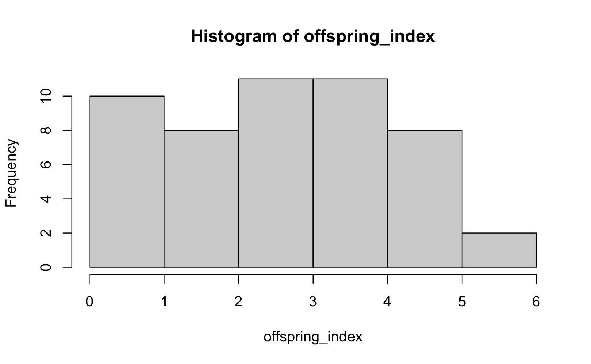
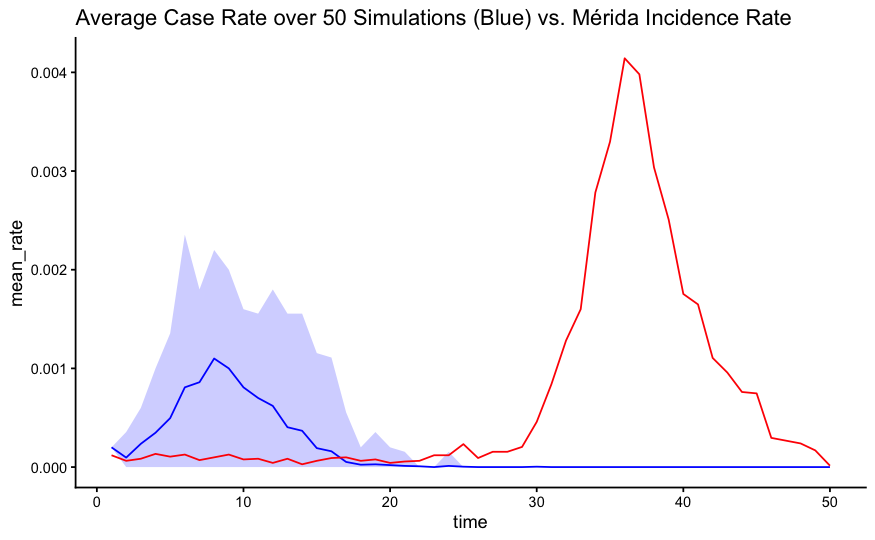
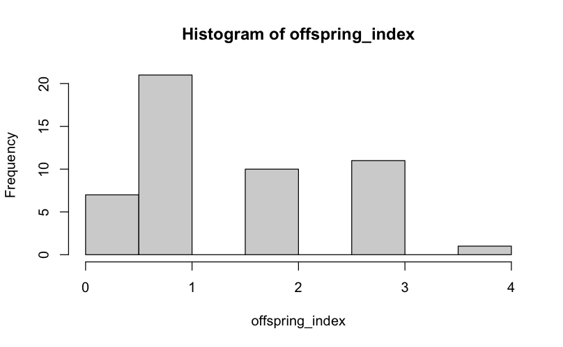
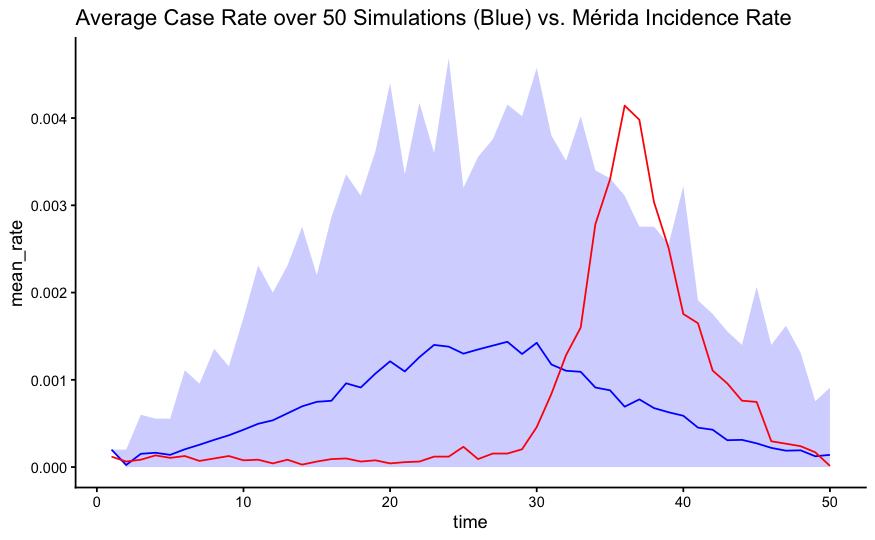
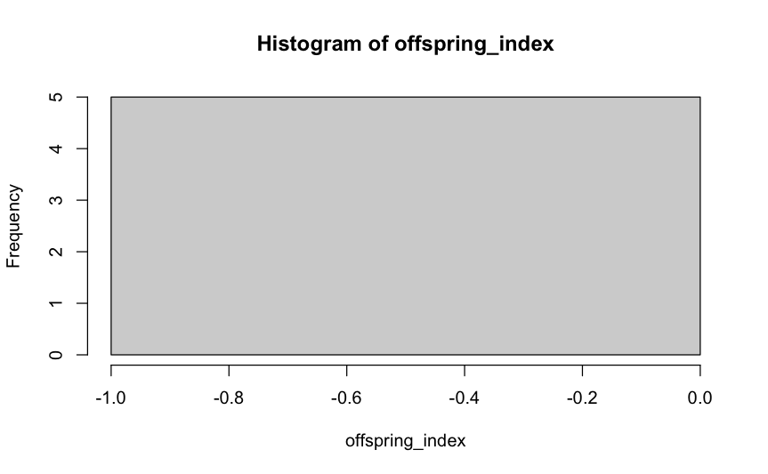
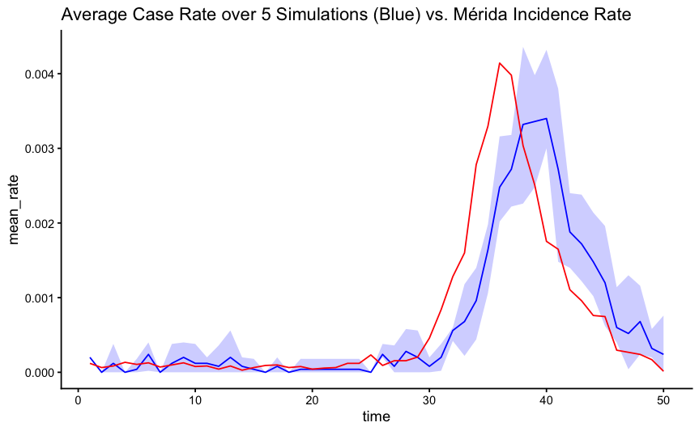
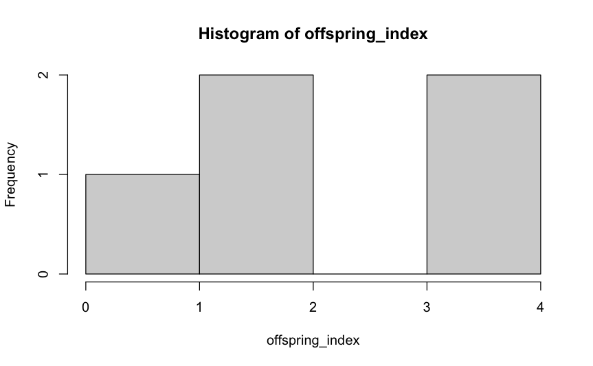
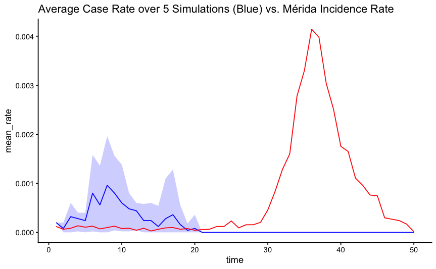
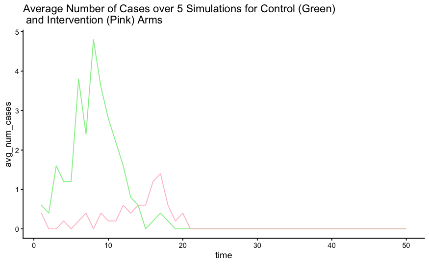

```{r}
library(here)
library(rio)
library(tidyverse)
library(lubridate)
library(ggplot2)
```

# Data
## Mérida Incidence
```{r}
## SINAVE case data, only dengue
sinave_dengue_cases <- here::here("data", "SINAVE_Data", 
                       "dengue_abierto.csv") %>%
  rio::import() %>% 
  dplyr::as_tibble() %>% 
  # only want data for Mérida + Kanasín (050, 041 MUNICIPO_RES)
  filter(MUNICIPIO_RES == 50 | MUNICIPIO_RES == 41) %>% 
  # change symptom onset date to match cases dataset (i.e., weeks since 
  #  start of ABD season)
  mutate(Week_onset = ymd(FECHA_SIGN_SINTOMAS),
         Week_onset = epiweek(Week_onset),
         Year = year(FECHA_SIGN_SINTOMAS)) %>%
  relocate(c(FECHA_SIGN_SINTOMAS, Week_onset), .before = ID_REGISTRO) %>% 
  filter(ESTATUS_CASO == 2) %>%  # 1 likely; 2 confirmed; 3 discarded
  mutate(age_grp = as.factor(ifelse(EDAD_ANOS < 18, "Child", "Adult")))

# incidence in merida??
city_cases_by_week <- sinave_dengue_cases %>% 
  count(Week_onset, name = "cases_per_week")
write.table(city_cases_by_week, file = "city_cases_by_week.txt", sep = " ",
            row.names = FALSE)

## divided by population...
yuc_pop <- read.csv("RESAGEBURB2020 - 31 Yucatán.csv")

I_m <- city_cases_by_week$cases_per_week #/ yuc_pop$POBTOT[1]


#there are a lot of cases at the beginning of the year here...are they part of the '23 outbreak?
# cases for '23 stop at 47 weeks...what about the rest of the year?
sinave_24 <- here::here("data", "SINAVE_Data",
                        "datos_abiertos_dengue_191224.csv") %>%
  rio::import() %>%
  dplyr::as_tibble() %>%
  # only want data for Mérida + Kanasín (050, 041 MUNICIPO_RES)
  filter(MUNICIPIO_RES == 50 | MUNICIPIO_RES == 41) %>%
  # change symptom onset date to match cases dataset (i.e., weeks since
  #  start of ABD season)
  mutate(Week_onset = dmy(FECHA_SIGN_SINTOMAS),
         Week_onset = epiweek(Week_onset),
         Year = year(FECHA_SIGN_SINTOMAS)) %>%
  relocate(c(FECHA_SIGN_SINTOMAS, Week_onset), .before = ID_REGISTRO) %>%
  filter(ESTATUS_CASO == 2) %>%  # 1 likely; 2 confirmed; 3 discarded
  mutate(age_grp = as.factor(ifelse(EDAD_ANOS < 18, "Child", "Adult"))) %>%
  count(Week_onset, name = "cases_per_week")
```

# Simulation
## Functions

```{r}
set.seed(12345)
```

### Trial Population Structure
```{r}
sim_pop <- function(n_clusters = 50, n_per_cluster, n_per_block, 
                    min_age = 1, max_age = 82){
  
  n <- n_clusters * n_per_cluster 
  
  trial_pop_df <- data.frame(
    "ID" = 1:n,
    "Cluster" = rep(1:n_clusters, each = n_per_cluster),
    "Block" = rep_len(1:round(n_per_cluster/n_per_block, 0), n_clusters),
    "TIRS" = rep(c(0, 1), each = n_per_cluster, length.out = n),
    "Age" = sample(min_age:max_age, n, replace = TRUE)
    )
  
  trial_pop_df$cluster_block <- paste(trial_pop_df$Cluster, 
                                      trial_pop_df$Block, sep = "")
  return(trial_pop_df)
}
```

### Infect Population
#### Generation Time
```{r}
# vector of generation time pmf given the parameters; 
# evaluated at each time point
gen_time <- function(Gmu, Gs2, max_gen_time) {
  shape <- Gmu^2 / Gs2
  scale <- Gs2 / Gmu
  
  i <- 0:max_gen_time
  
  genProb <- pgamma(i + 1, shape = shape, scale = scale) -
                pgamma(i,     shape = shape, scale = scale)
  
  return(genProb)
}
```

#### Infections
```{r}
infect_pop <- function(trial_pop, gen_prob, initially_infected = 1, 
                       alpha, beta, gamma, r) {
  
  N <- nrow(trial_pop)
  trial_pop$infected <- 0
  trial_pop$tau <- NA
  trial_pop$infector <- NA
  
  lambda_df <- data.frame(
    time = integer(),
    person = integer(),
    block = double(),
    cluster = double(),
    city = double(),
    total_hazard = double())
  
  # already?? infected??? within the trial???
  ## initial infections??????? 5 initial???
  initial_ids <- sample(1:N, initially_infected)
  trial_pop$infected[initial_ids] <- 1
  trial_pop$tau[initial_ids] <- 1
  trial_pop$index_case <- 0
  trial_pop$index_case[initial_ids] <- 1
  
  lambdas <- vector("list", N * trial_end)
  counter <- 1
  
  for (t  in 2:trial_end){
    
    new_infections <- c()
    
    for (j in 1:N){
      if (trial_pop$infected[j] == 1) { next }
      
      lambda_jb <- 0
      lambda_jc <- 0
      lambda_jm <- 0
      
      # block FOI
      same_block <- which(trial_pop$cluster_block ==
                            trial_pop$cluster_block[j] & (1:N) != j)
      for (i in same_block){
        if (trial_pop$infected[i] == 1) {
          dt <- t - trial_pop$tau[i]
          if (dt <= max_gen_time){ 
            if (trial_pop$TIRS[i] == 1) {
              lambda_jb <- lambda_jb + r * alpha * gen_prob[dt]
              # treatment reduction * cum. hazard from i infecting j * prob that gen time is dt
            } else {
              lambda_jb <- lambda_jb + alpha * gen_prob[dt]
              # cum. hazard from i infecting j * prob that gen time is dt
            }
          }
        }
      }
      
      # cluster FOI
      same_cluster <- which(trial_pop$Cluster == trial_pop$Cluster[j] 
                            & (1:N) != j)
      diff_block <- setdiff(same_cluster, same_block)
      for (i in diff_block) {
        if (trial_pop$infected[i] == 1) {
          dt <- t - trial_pop$tau[i]
          if (dt <= max_gen_time){ 
            if (trial_pop$TIRS[i] == 1) {
              lambda_jc <- lambda_jc + r * beta * gen_prob[dt]
            } else {
              lambda_jc <- lambda_jc + beta * gen_prob[dt]
              # cum. hazard from i infecting j * prob that gen time is dt
            }
          }
        }
      }
      
      # merida FOI
      for (z in 1:(t-1)) {
        dt <- t - z
        if (dt <= max_gen_time) {
          lambda_jm <- lambda_jm + gamma * (I_m[z] / yuc_pop$POBTOT[1]) * gen_prob[t - z]
          # cum. hazard from a case in merid * cases in merida * prob gen time is dt
        }
      }
      
      # total FOI on j
      lambda_j <- lambda_jb + lambda_jc + lambda_jm
      
      lambdas[[counter]] <- data.frame(time = t,
                                       person = j,
                                       block = lambda_jb,
                                       cluster = lambda_jc,
                                       city = lambda_jm,
                                       total_hazard = lambda_j
                                      )
      counter <- counter + 1
      
      # probability of infection given hazard
      p_j <- 1 - exp(-lambda_j)
      
      # j becomes a new infection
      if (runif(1) < p_j) {
        # possible infectors of j
        sources <- c(same_block, diff_block, 0)
        weights <- c(sapply(same_block, function(i) {
          if (trial_pop$infected[i] == 1) {
            dt <- t - trial_pop$tau[i]
            if (dt <= max_gen_time){ 
              base <- alpha * gen_prob[dt]
              # hazard from i infecting j * prob that gen time is dt
              if (trial_pop$TIRS[i] == 1) { base <- r * base }
              return(base)
            }
          }
          return(0)
        }), sapply(diff_block, function(i){
          if (trial_pop$infected[i] == 1) {
            dt <- t - trial_pop$tau[i]
            if (dt <= max_gen_time){ 
              base <- beta * gen_prob[dt]
              if (trial_pop$TIRS[i] == 1) { base <- base * r }
              return(base)
            }
          }
          return(0)
        }), lambda_jm)
        
        # pick infector
        if (sum(weights) > 0) {
          infector <- sample(sources, 1, prob = weights)
        } else {
          infector <- 0 # infection is imported
        }
        
        new_infections <- c(new_infections, j)
        if (infector == 0) {
          trial_pop$infector[j] <- 0 # imported infection
        } else {
          trial_pop$infector[j] <- trial_pop$ID[infector]
        }
      }
    }
    
    if (length(new_infections) > 0) {
      trial_pop$infected[new_infections] <- 1
      trial_pop$tau[new_infections] <- t
    }
  }
  lambda_df <- do.call(rbind, lambdas[1:(counter-1)])
  
  return(list(trial_pop = trial_pop, lambda_df = lambda_df))
}
```

### Summary Statistics
of the simulated populations
```{r}
get_summary <- function(infected_pop){
  # epidemic curve compared to real data :')
  incidence_df <- infected_pop$trial_pop %>%
    filter(is.finite(tau)) %>%
    count(tau, name = "cases") %>%
    complete(tau = 1:trial_end, fill = list(cases = 0)) %>%
    rename(time = tau) %>% 
    mutate(case_rate = cases / (n_clusters*n_per_cluster))
  
  real_df <- data.frame(
    time = 1:nrow(city_cases_by_week),
    case_rate = city_cases_by_week$cases_per_week / yuc_pop$POBTOT[1])
  
  plot <- ggplot() +
    geom_line(data = incidence_df, aes(time, case_rate), color = "blue") +
    geom_line(data = real_df, aes(time, case_rate), color = "red") +
    labs(title = "Simulated (blue) vs Real (red)") +
    theme_classic()
  
  # number of cases at the beginning ?
  head <- head(incidence_df, 10)
  
  # R_t? 
  offspring <- table(na.omit(infected_pop$trial_pop$infector))
  Rt_dt <- infected_pop$trial_pop %>% 
    filter(!is.na(infector)) %>% 
    group_by(time = tau) %>% 
    summarize (R_t = round(mean(table(infector)), 2))
  
  # distribution of secondary cases
  offspring_count <- as.numeric(offspring)
  
  hist_off <- hist(offspring_count)
  mean_off <- mean(offspring_count)
  var_off <- var(offspring_count)
  
  # fraction of infections from each source
  infec_frac <- infected_pop$lambda_df %>% 
    mutate(total = block + cluster + city) %>% 
    summarize(block_frac = round(mean(block / total, na.rm = TRUE), 2),
              cluster_frac = round(mean(cluster / total, na.rm = TRUE), 2),
              city_frac = round(mean(city / total, na.rm = TRUE), 2))
  
  # attack rate?
  attack_rate <- mean(infected_pop$trial_pop$infected)
  
  return(list("Epidemic Curve" = plot, "First 10 Infections" = head, 
              "Fraction of Infections from Each Source" = infec_frac,
              "Rt over time" = Rt_dt, 
              "Histogram of Offspring Distribution" = hist_off, 
              "Mean of Offspring Distribution" = mean_off, 
              "Variance of Offspring Distribution" = var_off, 
              "Attack Rate" = attack_rate))
}
```

1. epidemic curve
2. first few cases
3. R_t, effective reproductive number (average number of secondary cases?)


## Parameter Testing
### Set Up

```{r}
run_sims <- function(num_sims, trial_pop, gen_prob, initially_infected, alpha, 
                     beta, gamma, r, make_plots = TRUE) {
  
  sim_list <- list()
  offspring_index <- c()
  rr_peak <- c()
  time_diff_at_peaks <- c()
  control_list <- list()
  tirs_list <- list()
  prop_infected <- c()
  control_infected <- c()
  tirs_infected <- c()
  
  real_df <- data.frame(
    time = 1:nrow(city_cases_by_week),
    case_rate = city_cases_by_week$cases_per_week / yuc_pop$POBTOT[1])
  
  for (s in 1:num_sims) {
    infected_pop <- infect_pop(trial_pop, gen_prob, 1, alpha = alpha,
                               beta = beta, gamma = gamma, r = r)
    
    # epidemic curve
    ## average incidence across simulations
    incidence <- infected_pop$trial_pop %>% 
      filter(is.finite(tau)) %>% 
      count(tau, name = "cases") %>% 
      complete(tau = 1:trial_end, fill = list(cases = 0)) %>%
      rename(time = tau) %>% 
      mutate(case_rate = cases / (n_clusters*n_per_cluster),
             sim = s)
    
    sim_list[[s]] <- incidence
    
    ## by trial arm
    control <- infected_pop$trial_pop %>% 
      filter(is.finite(tau)) %>% 
      filter(TIRS == 0) %>% 
      count(tau, name = "cases") %>% 
      complete(tau = 1:trial_end, fill = list(cases = 0)) %>%
      rename(time = tau) %>% 
      mutate(sim = s)
    control_list[[s]] <- control
    
    tirs <- infected_pop$trial_pop %>% 
      filter(is.finite(tau)) %>% 
      filter(TIRS == 1) %>% 
      count(tau, name = "cases") %>% 
      complete(tau = 1:trial_end, fill = list(cases = 0)) %>%
      rename(time = tau) %>% 
      mutate(sim = s)
    tirs_list[[s]] <- tirs
    
    # count offspring
    index_ids <- infected_pop$trial_pop$ID[infected_pop$trial_pop$index_case == 1]
    count_offspring <- sapply(index_ids, function(id) {
      sum(infected_pop$trial_pop$infector == id, na.rm = TRUE)
    })
    offspring_index[s] <- mean(count_offspring)
    
    # find peak incidence in simulation
    study_peak <- max(incidence$case_rate)
    real_peak <- max(real_df$case_rate)
    
    rr_peak[s] <- study_peak / real_peak # difference in magnitude
    time_diff_at_peaks[s] <- incidence$time[which.max(incidence$case_rate)] - 
      real_df$time[which.max(real_df$case_rate)]
    
    peak_time <- incidence$time[which.max(incidence$case_rate)]
    real_peak_same_time <- real_df$case_rate[real_df$time == peak_time]
    rr_peak_same_time[s] <- study_peak / real_peak_same_time
    
    # proportion of population infected at end of season
    prop_infected[s] <- sum(incidence$cases) / (n_clusters*n_per_cluster)
    
    # num infected by trial arm
    control_infected[s] <- sum(control$cases)
    tirs_infected[s] <- sum(tirs$cases)
  }
  
  # epidemic curve
  if (make_plots == TRUE) {
    all_sims <- bind_rows(sim_list)
    epi_curve_summ <- all_sims %>% 
    group_by(time) %>% 
    summarize(mean_rate = mean(case_rate),
              lower = quantile(case_rate, 0.025),
              upper = quantile(case_rate, 0.975))
  epi_curve <- ggplot() +
    geom_ribbon(data = epi_curve_summ,
                aes(x = time, ymin = lower, ymax = upper),
                fill = "blue", alpha = 0.2) +
    geom_line(data = epi_curve_summ,
              aes(time, mean_rate),
              color = "blue") +
    geom_line(data = real_df,
              aes(time, case_rate),
              color = "red") +
    labs(title = paste0("Average Case Rate over ", num_sims, 
                        " Simulations (Blue) vs. Mérida Incidence Rate")) +
    theme_classic()
  all_controls <- bind_rows(control_list)
  all_tirs <- bind_rows(tirs_list)
  epi_curve_controls <- all_controls %>% 
    group_by(time) %>% 
    summarize(avg_num_cases = round(mean(cases), 2),
              lower = quantile(avg_num_cases, 0.025),
              upper = quantile(avg_num_cases, 0.975))
  epi_curve_tirs <- all_tirs %>% 
    group_by(time) %>% 
    summarize(avg_num_cases = round(mean(cases), 2),
              lower = quantile(avg_num_cases, 0.025),
              upper = quantile(avg_num_cases, 0.975))
  epi_curve_arms <- ggplot() +
    geom_ribbon(data = epi_curve_controls,
                aes(x = time, ymin = lower, ymax = upper),
                fill = "lightgreen", alpha = 0.2) +
    geom_line(data = epi_curve_controls,
              aes(time, avg_num_cases),
              color = "lightgreen") +
    geom_ribbon(data = epi_curve_tirs,
                aes(x = time, ymin = lower, ymax = upper),
                fill = "pink", alpha = 0.2) +
    geom_line(data = epi_curve_tirs,
              aes(time, avg_num_cases),
              color = "pink") +
    labs(title = paste0("Average Number of Cases over ", num_sims, " Simulations for Control (Green) \n and Intervention (Pink) Arms")) +
    theme_classic()
  
  hist_offspring <- hist(offspring_index)
  } else {
    epi_curve <- NULL
    epi_curve_arms <- NULL
    hist_offspring <- NULL
  }
  
  # R_0
  avg_offspring <- round(mean(offspring_index), 2)
  var_offspring <- round(var(offspring_index), 2)
  
  # rate ratio between study population and merida
  avg_rr_peak <- mean(rr_peak, na.rm = TRUE)
  var_rr_peak <- var(rr_peak, na.rm = TRUE)
  avg_time_diff <- mean(time_diff_at_peaks, na.rm = TRUE)
  
  # proportion of population infected
  avg_prop_infected <- mean(prop_infected, na.rm = TRUE)
  
  # avg infected by trial arm
  avg_control_infected <- mean(control_infected, na.rm = TRUE)
  avg_tirs_infected <- mean(tirs_infected, na.rm = TRUE)
  
  return(list(epi_curve = epi_curve, hist_offspring = hist_offspring,
              "Average R_0" = avg_offspring, "Variance of R_0" = var_offspring,
              "Num Simulations" = num_sims, 
              "Average RR at Peak Incidence" = avg_rr_peak, 
              "Variance of RR at Peak Incidence" = var_rr_peak,
              "Average Difference in Weeks Between Simulated Study Peak and City Peak" 
              = avg_time_diff, epi_curve_arms = epi_curve_arms,
              "Average Proportion of People Infected by End of ABD Season" =
                avg_prop_infected,
              "Average No. Individuals Infected in Control Arm" =
                avg_control_infected,
              "Average No. Individuals Infected in TIRS Arm" = 
                avg_tirs_infected))
}
```

Trial Population:
```{r}
min_age <- 1 # youngest age
max_age <- 82 # oldest age

trial_start <- 1 # first week of the year
trial_end <- nrow(city_cases_by_week) # 52 is the last week of the year but we don't have city incidence data for that??? so 50

# parameters
Gmu <- 2; Gs2 <- 1; max_gen_time <- 90 # 17 days?; 2 days?
# probability that the generation time = [index]
gen_prob <- gen_time(Gmu, Gs2, max_gen_time)

# Population size
n_clusters <- 10; n_per_cluster <- 500; n_per_block <- 50
trial_pop <- sim_pop(n_clusters, n_per_cluster, n_per_block)
```

### alpha
```{r, eval = FALSE}
Sys.time()
alpha <- -log(46/49); beta <- 0; gamma <- 0; r <- 1
run_sims(50, trial_pop, gen_prob, 1, alpha, beta, gamma, r)
Sys.time()
```
```{r, echo = FALSE, out.width='80%'}
alpha_results <- list(`Average R_0` = 3,
                      `Variance of R_0` = 2.73,
                      `Num Simulations` = 50,
                      `Average RR at Peak Incidence` = 0.3958843,
                      `Variance of RR at Peak Incidence` = 0.02140549,
                      `Average Difference in Weeks Between Simulated Study Peak and City Peak` = -27.8)
alpha_results

```
```{r, echo = FALSE, out.width='80%'}

```

### beta
```{r, eval=FALSE}
Sys.time()
alpha <- 0; beta <- -log(897/900); gamma <- 0; r <- 1
run_sims(50, trial_pop, gen_prob, 1, alpha, beta, gamma, r)
Sys.time()
```

```{r, echo = FALSE, out.width='80%'}
beta_results <- list(`Average R_0` = 1.56,
                      `Variance of R_0` = 1.11,
                      `Num Simulations` = 50,
                      `Average RR at Peak Incidence` = 0.5938264,
                      `Variance of RR at Peak Incidence` = 0.2034235,
                      `Average Difference in Weeks Between Simulated Study Peak and City Peak` = -18)
beta_results

```
```{r, echo = FALSE, out.width='80%'}

```

### gamma
```{r, eval=FALSE}
Sys.time()
alpha <- 0; beta <- 0; gamma <- 1; r <- 1
run_sims(5, trial_pop, gen_prob, 1, alpha, beta, gamma, r)
Sys.time()
```
```{r, echo = FALSE, out.width='80%'}
gamma_results <- list(`Average R_0` = 0,
                      `Variance of R_0` = 0,
                      `Num Simulations` = 5,
                      `Average RR at Peak Incidence` = 0.9655714,
                      `Variance of RR at Peak Incidence` = 0.003496231,
                      `Average Difference in Weeks Between Simulated Study Peak and City Peak` = 3.4)
gamma_results

```

```{r, echo = FALSE, out.width='80%'}

```

### r
```{r, eval = FALSE}
Sys.time()
alpha <- -log(46/49); beta <- 0; gamma <- 0; r <- 0.5
run_sims(5, trial_pop, gen_prob, 1, alpha, beta, gamma, r)
Sys.time()
```
```{r, echo = FALSE, out.width='80%'}
r_results <- list(`Average R_0` = 2.4,
                      `Variance of R_0` = 2.8,
                      `Num Simulations` = 5,
                      `Average RR at Peak Incidence` = 0.3282943,
                      `Variance of RR at Peak Incidence` = 0.0272706,
                      `Average Difference in Weeks Between Simulated Study Peak and City Peak` = -27.8)
r_results

```

```{r, echo = FALSE, out.width='80%'}

```

```{r, echo = FALSE, out.width='80%'}

```

## Grid Search

parameter grid search (just testing to see if this will run for now)
```{r, eval=FALSE}
param_grid <- expand.grid(
  alpha = c(0, -log(46/49)),
  beta  = c(0, -log(897/900)),
  gamma = c(0, 1e-6)
)

grid_results <- vector("list", nrow(param_grid))

for (p in 1:nrow(param_grid)) {
  a <- param_grid$alpha[p]
  b <- param_grid$beta[p]
  g <- param_grid$gamma[p]
  
  sim_out <- run_sims(1, trial_pop, gen_prob, 1, a, b, g, r = 0.5, 
                      make_plots = FALSE)
  
  grid_results[[p]] <- data.frame(alpha = a,
                             beta = b,
                             gamma = g,
                             avg_R0 = sim_out$'Average R_0',
                             avg_RR_peak = sim_out$'Average RR at Peak Incidence')
}

grid_results_df <- bind_rows(grid_results)
```

```{r, echo = FALSE}
grid_results_df <- readRDS("grid_results_df.rds")
grid_results_df
```


output function
```{r, echo=FALSE}
# proportion of cases (vs. entire population)

# Poisson regression for efficacy estimates

# Average number of cases in both arms?
```


